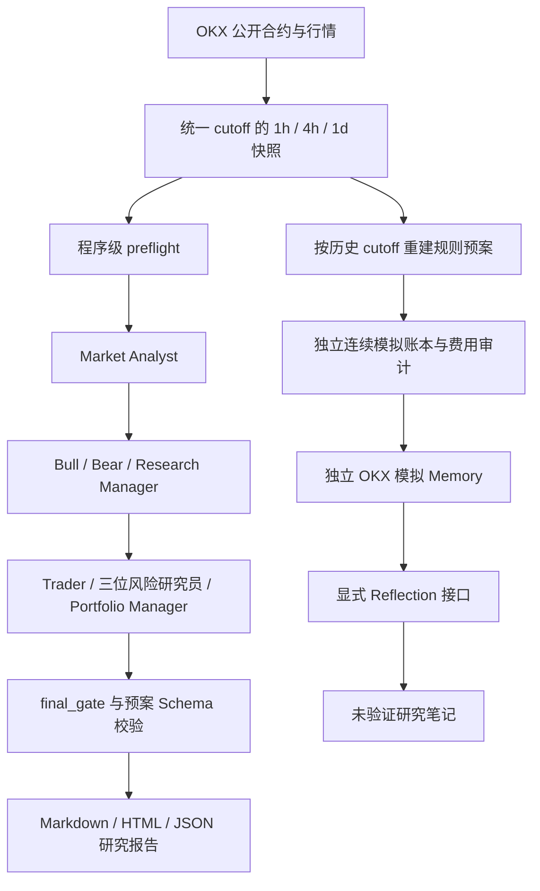

# TradingAgents 0.7.0 OKX A—D 最终验收

验收日期：2026-10-23；Windows 11、Python 3.13.13；工作区 `D:\_01trading_agents`；分支 `feature/okx-usdt-perpetual`。

**总体结论：作为限定范围的投研工作区，有条件通过。不是全量测试全绿的正式发行版，不是已证明盈利的策略，也不具备实盘准入条件。** 本轮只新增验收文档及独立审计产物，未修改产品源码、Agent、策略、配置或执行逻辑。

## 分项评价

| 能力 | 评价 | 验收范围及条件 |
|---|---|---|
| 数据研究能力 | 通过 | BTC-USDT-SWAP 公开 REST、1h/4h/UTC 日线、同源指标及质量闸门；本轮公开集成 11/11 通过。可选衍生品有 TTL 和历史覆盖限制，不能理解为任何日期任何品种均完整。 |
| 多 Agent 研究能力 | 有条件通过 | 原九角色流程真实成功记录存在；D.4.1 为 6 成功/8 失败。长流程服务稳定性及恢复后的真实成功率尚未确认。 |
| 多空交易预案能力 | 有条件通过 | 方向、价格、数量、成本、状态机与 Schema 校验已实现；有效 LONG/SHORT 路径主要由 MOCK 验证。已保存真实完整研究为 WAIT，不能声称真实机会入场链已验证。 |
| 历史回测能力 | 有条件通过 | 386 天、14 笔连续账本与本轮重放完全一致；历史参数、精确资金结算价格及数据原始发布时间仍有假设；未验证实盘保证金或强平。 |
| Memory / Reflection 能力 | 有条件通过 | 独立模拟存储、归属、幂等与时间隔离通过；现有 2 条反思是固定 MOCK 示例。真实 Reflection 质量未验证，未接入实时 Graph，不是自动学习闭环。 |
| 端到端运行能力 | 有条件通过 | 当前工作区内公开数据→多 Agent→报告曾真实完成；本轮核验保存记录、整体离线图和公开数据，未重跑昂贵完整 LLM。依赖正确 cwd，且全默认测试仍有 5 个既有 Windows 失败。 |
| 实盘交易准备程度 | 未通过 | 按设计禁止实盘。没有订单执行、账户级风控、交易权限隔离实证、实际保证金/强平验证或上线准入；execution_enabled=False。不得将研究状态当作订单授权。 |

## 本轮验证证据

证据根目录：[ad_20261023](C:/Users/jerry_su/.tradingagents/logs/acceptance/ad_20261023)。

| 检查 | 实际结果 |
|---|---|
| 全默认离线测试 | **1748 passed、5 failed、4 skipped、12 deselected**；另 **100 subtests passed**；120.98 秒。网络 integration 默认排除，不是所有外部服务全量测试。 |
| 原始 HEAD 对照 | 在独立导出快照中，仅重跑上述 5 例，**5 例相同失败全部复现**，9.54 秒。未切换或覆盖当前工作区。 |
| OKX 公开集成 | **11 passed**，97.92 秒；公开 GET，无账户、无订单、无真实模型调用。覆盖 1h/4h/1d、衍生品、历史隔离、多周期及真实行情+模拟 WAIT 的 Schema 交付。 |
| 本轮真实 CLI 数据运行 | `okx-research --interval 4h --multi-timeframe --derivatives --data-only` 退出码0；核心 VALID、衍生品 VALID、allow_new_risk=True、execution_enabled=False，无模型调用。独立报告位于证据根目录 cli_public_run/reports/okx_BTC-USDT-SWAP_multi_f9b6ffb85713；研究许可仍不等于交易许可。 |
| CLI 帮助 | 主入口及 9 个研究/回测/恢复入口，共 10 个 help 调用退出码全部为 0；这不等于所有有成本子命令已经重跑。 |
| 直接核心依赖 | pyproject 的 19 项直接运行依赖均满足当前版本要求；无安装、升级。未进行完整传递依赖求解。虚拟环境没有 pip；未将其误报为依赖安装失败。 |
| 386 天账本重放 | 使用冻结决策和原公开历史输入，trades/events/equity_curve/metrics **完全一致**，未再运行逐点完整 Agent。 |
| 费用审计 | 原 14 笔全部算术通过；历史参数和资金价格限制仍保留。输出目录摘要与原 D.3.1 审计一致。 |
| 已保存研究报告 | 核对 12 个 OKX 报告目录；两份阶段 C JSON 可被当前 Pydantic 模型解析；保存三周期每周期 400 根、统一 cutoff、无未来收盘。保存数据是历史证据，不是当前有效报价。 |
| 原实验保护 | D.4.1 **146 个文件**与 D.4.2 保存清单逐项 SHA-256 一致；原 14 例、279 候选层、报告及盲测协议未更改。 |
| D.5 时间隔离 | 14 条模拟反馈；6 完整/8 模型失败。所有原历史 cutoff 均读不到今天的反馈或反思。MOCK 不进入正式上下文。 |
| 工作区检查 | 23 个已跟踪文件有历史未提交修改；验收前细分为 78 个未跟踪文件。完整清单见 git_inventory.json；新增本目录文档后 untracked 数量会增加，未自动提交或推送。 |
| 格式检查 | git diff --check 通过；没有据此宣称所有未跟踪文件都经过静态分析。 |

原 5 个失败：

1. `test_chatgpt_auth.py::test_a_token_near_expiry_is_renewed_with_the_stored_refresh_token`：POSIX 0600 模式断言在 Windows 不成立。
2. `test_chatgpt_auth.py::test_signing_in_by_pasting_the_redirect_saves_a_private_sign_in`：同类模式断言。
3. `test_cli_updates.py::test_the_upgrade_command_follows_the_install`：安装/升级路径及环境假设不适配当前 Windows。
4. `test_cli_updates.py::test_a_uv_git_install_is_upgraded_with_uv`：同类升级命令假设。
5. `test_suite_isolation.py::test_yfinance_keeps_its_cache_out_of_the_users_home`：Windows TEMP 位于用户 home 下，不能以“非 home 子目录”判断隔离。

前两项不证明真实登录文件的 Windows ACL 安全或不安全；本轮未读取真实凭据内容，也未独立认证 ACL。4 个 skip 分别是 3 个 POSIX 权限测试和未安装可选 langchain_aws 的 Bedrock 测试。未发现新增的股票核心测试失败；本轮没有重新调用真实 Yahoo 或真实股票 LLM，因此不作外部股票供应商当前可用性保证。

## 功能完整性与依赖链

图中 **N 没有连接回实时研究 Graph**。阶段 A 的 OI/盘口只是可选证据；阶段 B 必需三周期失效会阻断研究。C/C.1 的候选有效、确认窗口、短市场 TTL 和入场重验不是同一时钟。D 的账本是完全离线模拟，不是执行层。D.4 对照固定候选与成交规则，D.5 不改变策略。

完整逐项状态见 [function_inventory.md](D:/_01trading_agents/docs/acceptance_20261023/function_inventory.md)。

## 历史结果、Agent 对照与稳定性限制

原回测窗口 `[2025-10-01T00:00:00Z, 2026-10-22T00:00:00Z]` 的终点用于最终边界开盘结算，跨度 386 天。原始数据含预热及覆盖验证尾部：1h 9667 根、4h 2719 根、1d 789 根、资金结算档案 1161 条、标记价格 9265 根；这些计数不是全部用于决策的窗口内条数。1h 最末根的收盘在终点后一小时，账本终点分支只使用其开盘价、不会用终点后的高低收盘形成信号或收益。策略输入按各历史 cutoff 再截断，资金费率只用于后续费用，不用未来费率做信号。

- 2316 个决策点、279 个候选（49 LONG、230 SHORT）；142 个实际进入突破等待，37 个完成突破，14 个回踩并成交；117 过期、11 失效。137 个候选因已有持仓/假设被跳过。
- 14 笔（2 多、12 空），胜率 **28.5714%**，Profit Factor **0.873656**。
- 初始权益 10000，期末 **9978.03516997 USDT**；净损益 **−21.96483003 USDT**，净收益率 **−0.219648%**，小时权益最大回撤 **1.377778%**。
- 手续费 **13.943115815**、滑点影响 **5.59425**、资金现金流代理 **+0.2980157802 USDT**。滑点已经体现在成交价中，不能再从净损益重复扣除。
- 成本场景：低成本 3bps/1bps 为 **−13.60166342**，基准 5bps/2bps 为 **−21.96483003**，高成本 8bps/5bps 为 **−38.69935933 USDT**。这是固定成交样本的成本敏感性，不是新策略或账户真实费率。
- D.4 的 3 个真实研究候选未成交，无法评价筛选收益。D.4.1 的 14 个回顾性成交条件样本中，6 个真实模型完整结果全部 ACCEPT，8 个失败；265 个候选未研究。A 与按既定不确定性回退政策重放的 B 净损益完全相同。失败不能算成功避险，不能从 6 例推出 Agent 优势。
- D.4.2 修复安全分类/有限恢复，旧 8 例的服务细因因日志缺字段仍不可追溯，未恢复成新成功决策。本轮没有再次发起这些模型调用。
- D.5 的一次真实短探测：2026-10-23 06:07:59 UTC，10.63 秒，完整 OK，21 输入/5 输出/26 总 Token。长流程、真实恢复、真实 Reflection 的可靠性不能由这一次探测替代。

所有已查看历史是开发集。受保护未来区间 `[2026-10-24, 2027-01-24)` UTC 未运行。本轮没有读取该区间数据、调参或开展自动策略优化。历史截断不能消除 LLM 训练知识的事后污染。历史合约参数连续性、实际成交顺序/流动性、精确资金结算标记价格及原始发布时间尚不完整；没有保证金、杠杆、强平或实盘盈利证明。

## CLI、Schema、文档一致性

主要参数与实际 argparse/Typer help 一致，运行手册使用实际入口，不把独立的 D 阶段 Python 模块虚构为 okx-research 子参数。`--trade-plan` 自动启用多周期和衍生品；费用需显式假设。`allow_new_risk` 在非预案研究中表示数据可支持研究，不是交易权限；预案结果固定 false。

已发现并保留的差异：

1. 保存的阶段 C Schema 与当前 Schema 不完全相同：当前新增 `signal_state/signal_timing`，但仍标 `okx-research-plan-v1`。旧 JSON 可解析，尚不是破坏性不兼容；外部消费者应使用报告自带 Schema，不假定同名 v1 的结构永远相同。
2. 早期文档的“三个公开路径”“尚无回测引擎”等为对应阶段交付时的状态，已经被后续阶段覆盖；不能当作当前能力总表。以本目录清单和源码为准，不改写历史验收记录。
3. Markdown `Generated` 使用本地无时区字符串；行情 cutoff/close 有明确 UTC，报告生成时间展示仍有歧义。没有修改旧报告。
4. D.4.1 的冻结代码校验不能被绕过。升级客户端后，不应拿当前代码直接执行旧实验的 --execute/--analyze 并覆盖其目录。原封存结果可离线读取，新恢复必须单独标记探索性。
5. 当前新增 OKX 模块在工作区可用；从工作区外执行独立脚本时，观察到解释器导入 `.venv/Lib/site-packages/tradingagents` 原版包并缺少 okx_backtest。没有安装/重装来掩盖该问题，手册要求先 cd 到项目。正式打包及离目录导入未验收。

## 安全与交付边界

研究适配器只有固定官方公开 GET allowlist，拒绝其他路径与重定向；未发现这些 OKX 研究模块包含 trade/account/asset 写入路径或签名头。真实模型工具是研究工具，不把 Codex 的 OKX live MCP 注入 Agent。MCP/API Key 具体权限未在本轮试探，不宣称其已只读。模型代理配置未修改，TLS 验证未关闭。

本轮没有 commit、push、切分支、删除或覆盖历史源码/报告、安装依赖或修改盲测协议。当前 working tree 大量增量未提交，验收对象是工作区及所保存指纹，不是仅凭 Git HEAD 能复现的发行物。

运行说明见 [runbook.md](D:/_01trading_agents/docs/acceptance_20261023/runbook.md)，遗留优先级见 [issues.md](D:/_01trading_agents/docs/acceptance_20261023/issues.md)。本轮验收结束，停止，不自动开发后续阶段。
