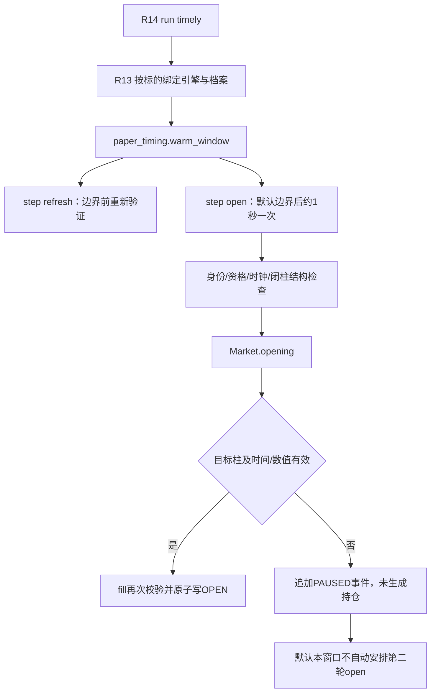

# F3 及时观测兼容性专项设计评审（仅设计）

状态：DESIGN_ONLY / AWAITING_IMPLEMENTATION_AUTHORIZATION。
研究分支：codex/f3-timely-observation-compatibility。
已固化诊断基线：8f359cfacb8b1726640f08473d39e69eac3f81ac。
父级R1.4基线：01b82f435bb3631d3325e3a440b356d32bbb1312。
本文件不启用任何协议、代码路径、部署或定时任务；不改变任何原始档案。

## 1. 诊断成果版本固化

origin2=https://github.com/jubinnautialj-hue/TradingAgents.git。
仅提交4个已验收文件：quote_probe_diagnostics.py、对应测试、quote_probe_d31.md、quote_visibility_d321.md。
159项专项及兼容测试再次通过（85.75秒），敏感格式扫描未命中真实凭据；测试内SECRET字符串为固定脱敏夹具。AGENTS.md、认证、日志、原始实机JSON/JSONL未提交。

| 实验 | 实际工具版本 | 可核验SHA256 | 结论 |
|---|---|---|---|
| D3.1 | public-quote-diagnostics-d31-v1 | 135a13fced716aadf60e36265373a61b0d59de96516aa67203481bcd4e6218fe | 旧独立timed仍fail-fast，增加报价诊断；旧副本保存在Vultr |
| D3.2.1 | public-quote-diagnostics-d321-v1 / d321-hour-visibility-v1 | 76285bc58be122a9f72574179cf9be3c6dd069fb8fccaec0cdb9520242da152c | 独立故障隔离/有界可见性采样，159项测试及非整点验证 |
| D3.2.2 | 同D3.2.1，无正式F3改动 | 同上；一次性runner c293818f7aa2ce1936e44d3f99e248af0d04af5e15ef801ebfbd083b0ea77a1d | 2026-10-25 02:00UTC单次诊断实验通过 |

Windows工作文件、Git暂存blob、Vultr D321副本均匹配76285...；D31旧SHA不等于新版是明确版本差异，不是文件漂移。runner及原始运行档案不属于本次Git交付。旧版本的文档作为历史版本说明保留，不能用旧SHA校验新版本。

## 2. 实测证据与适用边界

D3.2.2目标2026-10-25 02:00UTC/北京时间10:00。BTC首查响应+1.035秒有效；ETH首查+1.301秒缺目标柱，二查+5.039秒有效；SOL首查+1.535秒缺目标柱，二查+5.283秒有效。
实际HTTP：时钟1次、BTC1次、ETH2次、SOL2次，共6次，各请求HTTP200，无隐藏网络重试。ETH/SOL首查ValueError定位forward_paper.py:254的目标柱匹配条件。没有正式F1/F2/F3样本。

首次可见是离散采样中最早实际收到目标柱的时刻，不是API实际发布或全局生成时刻，不能用两次观测反推出缓存节点的连续状态。官方说明市场数据服务使用独立缓存，后一次可返回更旧数据；这解释了候选机制，但不能证明本次命中哪个缓存或具体延迟来源。

本评审使用已验收的脱敏总结；不将原始实机运行档案加入Git，不用已查看案例冒充未来盲测，不重放过去整点形成新前向成交。

## 3. 当前源码调用链与准确失败语义

代码证据（相对本研究基线）：

- forward_paper.py:134 next_open：确认及重新验证完成时刻之后严格下一整点，恰好整点完成也选再下一个整点。
- forward_paper.py:248 Market.opening：GET /api/v5/market/candles，instId不改名、bar=1H、limit=2，无after/before；只匹配唯一9字段目标ts；读取open、成交量存在性和confirm0，不消费当前柱未来HLC。
- forward_paper.py:253-260：目标柱不存在/重复、开始过早、接收过晚、confirm/成交量无效、非法价格均拒绝。异常文字不是“仅超时”的证明。
- paper_timing.py:step：验证F1/F2来源、准入、已收盘结构；opening失败捕获为PAUSED并追加审计。异常隔离是逐候选已经存在的能力，不需重建。
- paper_timing.py:warm_window：默认每个候选本次窗口调用一次open，通常目标+1000ms发起；本函数没有1/5/9秒重查循环。超时/预算耗尽仍可能使后续候选无法执行，已有异常捕获不等于有资源公平性保证。
- forward_paper.py:scan（约605-650行）：普通扫描同样逐记录捕获错误并继续；目标+15秒以后在后续推进中标MISSED，失效/过期标CANCELLED。
- forward_paper.py:Ledger.states：PAUSED事件没有state时，不覆盖上一次SCHEDULED状态。因此首查异常不是必然立即终态；如果另一次调用确实发生在同一15秒窗口内，且资格仍有效，现有底层可能再次尝试。默认定时频率并不保证这种重入。

**必要澄清**：独立旧run_probe的全批fail-fast不能套用为正式F3全部行为。“最多一次请求”不是PaperProtocol的显式Literal字段；它主要是当前warm_window调度实现。v1也未赋予任意数量补查或延长TTL的许可。推荐对新的正式采样策略版本化，而不是声称底层v1从数学上绝对禁止第二次GET。

## 4. 原15秒的精确定义与禁止倒签

令T为提前持久化的planned_entry_ms，D=T+15000。

原fill强制：

`T <= request_started_ms <= observed_ms <= fill_check_now <= D`

因此仅“响应在15秒内”不足够；fill决策也必须在窗口内。Market.opening核验acquired<=D，fill再核验now<=D。
其他条件保持：SCHEDULED、独立纸面资格、schedule_persisted_ms<T、CONTEMPORANEOUS、boundary_ms=T、重新验证在T前完成且在fill时未过期、策略未过期、入场价/数量/现金/精度均有效。

原fill已把position.entry_ms保存为实际opening.observed_ms，而不是T；同时reference_boundary_ms=T、entry_reference为该小时o。该价格是明确的“小时开盘价代理+不利滑点”的纸面假设，不是观察时刻真实可成交价格。不能因entry_ms准确就宣称价格可实际成交。

不得：将5秒后取得的价格倒填为T成交、把HTTP发送当接收、用缓存旧柱替代目标柱、把Ticker.ts当小时边界、窗口后补采开盘价、在T后重新验证来延长原边界前TTL、挑选更有利的后续价格。

结算也需保留当前规则：settle按position.entry_ms<fundingTime判断是否跨过资金结算；不是在整点自动收费。advance_bar已有入场柱先后顺序不明时保守/UNRESOLVED处理；补查延迟扩大这项不确定性，不能取消保护。

## 5. 三方案比较

| 维度 | A：保持当前单次open调用 | B：15秒内有界补查，新观测扩展 | C：其他公开实时价格，新成交价协议 |
|---|---|---|---|
| 协议兼容 | 原样v1；保持现有暂停/过期流程 | 数字窗口及每次原生校验可不变；采样/可接纳机会扩大，需独立版本 | 改变价格定义和可能的时间标签，必须新成交价协议 |
| 成交假设 | 小时o+不利滑点，entry_ms=接收时间 | 仍小时o+原成本、实际接收时间；不能假装报价在T已知 | last/bid/ask或公开成交价不等于小时o，改变成交与成本假设 |
| 可观测性 | 首查旧柱时原因需要补充；保留失败 | 每次请求/缺柱/首个有效/预算/接收/决策均审计 | 需保存价格生成ts、客户端收取时间、价源/价差及新鲜度 |
| HTTP预算 | 报价每候选默认1次；另有资格/时钟/闭柱/重新验证 | 三候选报价最多9次实际发送，统一整任务预算，不是简单总量10 | 至少每候选1个新价格请求；趋势K线/校验仍需原请求，不能以替代接口省略 |
| 限速 | 原生0.25秒间隔及有限底层重试，但20秒read超时可超过15秒 | 新报价专用短超时、明确实际发送预算，禁隐藏重试，所有轮次均在D前 | ticker官方20次/2秒/IP，仍有缓存与陈旧问题；WS另需连接与连续性规则 |
| 数据真实性 | 本次仅BTC首查成功；漏过可见性稍晚的机会 | D3.2.2支持可行性，但只有单整点、无正式入场 | 未实测；当前报价不是历史开盘价，也不保证数量可成交 |
| 复杂度 | 最低，无新代码 | 中等；复用原校验/账本原语与R13绑定，新增观测策略和审计 | 较高；价格、滑点、数量、风险收益/资金计价和首柱逻辑需复核 |
| 旧账本 | 原样读取 | 新命名空间/新策略哈希，旧账本不迁移、不混算 | 同样独立，绩效不可与旧价源直接等价比较 |
| BTC/ETH/SOL | 维持各自原准入/合约证书 | 组合parent paper policy + R13 instrument admission + 新观测策略 | 每标的验证行情标识、精度、价源新鲜度；不能只通过Ticker即获得纸面准入 |

### C的官方接口依据与限制

官方[GET Ticker](https://app.okx.com/docs-v5/en/#order-book-trading-market-data-get-ticker)提供last、bidPx、askPx及ticker生成时间ts；不是小时开盘接口。官方Ticker限速20次/2秒/IP。UTC日开盘字段sodUtc0不是1H开盘，不能拿它替换小时o。
官方[Market Data](https://www.okx.com/docs-v5/en/#order-book-trading-market-data)说明独立缓存，故换Ticker不能自动消除缓存风险。若将多头参考改为ask、空头改为bid，还需明确spread与原2bps滑点是否重复计成本、报价规模是否足够；“last”不能直接宣称可成交。1H已收盘K线继续只用于趋势/条件确认。
本轮不新增Ticker或WS实测，不选择C作为立即实施方案。

## 6. 推荐方案与拟议协议（均未启用）

建议保留A作为旧版控制组，**批准独立开发B的最小原型**，不修改forward-paper-v1。
拟议名称：`forward-paper-opening-observation-v1`（独立观测扩展，而非把父协议改名）。

拟议机器字段，后续实施时才创建Schema/配置：

- version、parent_paper_policy_hash、instrument_admission_hash、observation_code_hash。
- fixed_window_ms=15000，round_offsets_ms=[1000,5000,9000]，per_candidate_attempts<=3。
- price_source=OKX_MARKET_CANDLES_1H_OPEN，entry_time_rule=ACTUAL_RESPONSE_RECEIVED。
- selection_rule=FIRST_VALID_OBSERVATION，不在成功后再择价。
- retryable_reason=TARGET_BAR_NOT_VISIBLE；有限网络瞬时错误是否允许下一轮须预先列入审批，不从泛化ValueError自动重试。
- any_existing_quality_failure/EXPIRED/INVALIDATED/geometry_failure禁止补查变成成交；收到目标柱但价格/成交量等无效应终止该候选。
- execution_enabled=False、allow_new_risk=False、simulation_admitted=False，paper_evaluation_eligible仅纸面评价。
- 新规则在任何候选结果产生前封存并写入identity；不依据后续盈亏选择适用候选。

B可以沿用原小时开盘参考价、止盈止损、5bps手续费、2bps滑点与12根最大持仓等父模型，但明确扩大“能拿到有效观测”的样本集合。因此不能以“数值价格公式不变”为由与旧协议混记。

## 7. 最小实现范围与复用边界

后续获授权才拟新增：

1. 一个独立观测扩展模块（建议forward_paper_observation.py），定义有界采样器/typed原因/审计模型；不用诊断程序的全局Session猴子补丁作为正式生产设计。
2. 一个协议JSON与Schema（建议forward_paper_opening_observation_v1.*），显式父协议/标的准入/预算与成本不变。
3. 新命名空间引擎与显式路由选项，默认关闭；复用paper_instruments.py的私有函数依赖绑定方式、native Market.opening/fill/settle及锁/原子写原语，不复制另一套成交计算。
4. 专项测试与运行手册；必要路由改动只触达经评审的非冻结扩展层，避免改旧核心字节。

forward_paper.Ledger.load同时校验policy与整文件CODE_HASH，R13还把paper_timing.py等哈希纳入引擎。因此直接编辑这两个旧文件，即使只加日志，也可能破坏旧账本加载；这是P0兼容约束。旧core和旧timely adapter保持原样，新模块显式选择新引擎。不能修改旧journal的code_hash来适配新代码。

新账本身份建议含exchange+instrument+parent-policy+instrument-profile+observation-policy，目录按组合指纹隔离。旧BTC v1、ETH/SOL R13账本继续由原引擎读取；旧SCHEDULED不自动转入B，不复制F1或F2原记录。未来候选采用哪一组必须在边界前持久化。

## 8. 15秒内补查的边界与预算

- 1/5/9秒只是每轮最早网格，串行三标的会有实际偏移；必须记录真实发送/接收，不能伪造同时1.000秒。
- 每轮对尚未确认候选各一次，单候选最大3次，报价部分全局最大9次HTTP；隐藏底层网络重试也计量。当前timely_http_cap默认60是**整个任务**预算，还要容纳market.now、闭柱结构、重新验证及分页。
- D3.2.2只用了1次时间+5次行情，没有运行正式准入/结构/重新验证，不能把“10次诊断上限”当成完整F3预算。
- 预留报价额度只是分配，不自动增加60的总预算。正式实现前应先量测边界前/边界后校验成本；若剩余不够，明确未确认，不能少做质量校验。
- PublicBudgetClient每逻辑GET最多3次HTTP、原socket(5,20)秒不适合15秒内最坏场景。B应使用独立deadline感知公开GET传输（不更改旧供应商），单次总socket预算建议<=1秒并受剩余窗口约束；429/Retry-After或权限拒绝应终止/暂停相应实验，不绕过限制。
- Linux专用轻量进程提供硬截止兜底，HTTP/解析/fill及持久化前再次检查时间。期限外回来的数据可留诊断，不得OPEN。及时任务不得和长模型任务共用监督锁。
- 同一phase仍互斥；不要持有跨标的全局账本锁等待下一轮。逐账本短事务与串行公平采样相结合；一标的网络阻塞必须有短截止，才不会拖垮全部。
- 现有每次step都会验证时钟和闭柱结构；不能直接重复调9次step却沿用诊断10请求假设。先复用和量测原检查，若确需缓存已验证历史前缀，仍须核对目标边界刚收盘柱并记录指纹；不能为赶15秒省略确认。

## 9. 审计、崩溃恢复与不得倒签

每次发送前记录消耗attempt_id=hash(registration_id,instrument,policy_hash,T,round_index)。记录plan_id/trigger_id、F1/F2指纹、R13证书、请求发送/响应接收/校验完成/实际入场时间、返回柱边界/confirm/摘要、HTTP状态/底层尝试数、错误分支、单调时钟偏移和预算。

SCHEDULED必须在T前持久化；所有attempt都是追加事件。两进程竞争同一账本只允许一个写入者；重启重新读取最新OPEN/SETTLED等状态，绝不重复fill/计费。
发送后崩溃但没有完整响应证据的attempt标记未确认并保守消耗额度，不补写成功、不重发同一attempt；只有D前且剩余轮次/资格仍有效时才可按新协议继续。D后启动只能记录MISSED或无法确认，不能补采过去开盘价。
选择首个有效实际响应，立即停止该候选补查。fill时仍执行父规则；入场时间=实际接收ms，不是T或轮次计划时刻。重新验证只能用T前完成的有效证明；不能延长TTL或改原研究条件。

资金费率适用性仍按实际entry_ms与结算时刻，保留当前历史mark代理限制；最大持仓及首柱止盈止损不确定性沿用父规则，不声称观察延迟内的价格路径或真实盘口成交已被验证。

## 10. 统计与版本对照

旧compare_pair要求双方policy_hash等于当前POLICY_HASH；新观测策略组不能默默绕过此检查。新增跨观测策略设计对照接口须显式报告共享研究cutoff/计划T/成本/标的及观测策略差异，旧统计函数不改。
同一注册/行情的A/B结果属于配对工程样本，不是两个独立市场样本；不同协议有不同可入场集合。不得从诊断失败后的补查成功推导策略收益改善，不把B接受交易利润直接加到A账本。
没有正式前向成交时报告0样本/未定义，不用D3.2.2诊断值制造模拟收益。

## 11. 实施前必须新增的测试与实机门槛

确定性测试：

1. 首轮三标的成功；BTC首轮失败但ETH/SOL仍执行；单标的持续失败整体不能全通过。
2. 缺目标柱后5秒出现；目标柱收到但无成交/confirm错误/非法价不得择优再试。
3. 14.999秒接收但fill跨15秒，拒绝；15秒边界精度、单调时钟跳变和server/local偏移。
4. 429/超时/连接中断、剩余预算不足、HTTP实际尝试计量；低速HTTP/DNS由进程截止控制。
5. prevalidation在边界前完成但补查前已过期、结构失效、假设到期、证书变化，均禁止入场。
6. 发送前/发送后/接收后/fill后崩溃，重复扫描/进程并发不重复开仓或收费；不能选择已过去整点。
7. 三标的同价格/时间仍保持账本隔离，继承R13数量与费用换算；未批准标的拒绝。
8. 旧v1/R13账本用旧引擎读取不变，新引擎拒绝旧链混写；协议/代码哈希、篡改和配对边界。
9. 保留entry_ms为实际接收及首柱保守退出/资金结算规则，不把历史K线补采冒充实时。
10. 新开关关闭时旧CLI行为不变，A—D/F1—F3/R1.1—R1.4及股票相关回归。

未来实机试验须另行授权：先零正式候选的隔离三标的采样，再新namespace受控正式纸面准入；重复多个预先指定整点，包含缺柱/超时/重启和并发模型负载情景。记录实际分母，不能反复挑选成功整点。正式样本不足时明确未验证，不用夹具填充。
本轮只复核既有159项测试，没有实现或声称上述新机制测试通过，没有安排新实机试验。

## 12. 对D3.3/D4及是否进入开发的结论

建议：**设计评审有条件通过，可申请B的独立正式代码开发；本轮不实施。** 前置条件是批准新观测扩展、独立账本/路由、硬截止和预算、旧链不迁移、全部安全字段False。

D3.3单BTC完整研究可另行作为受控模型/资源测试申请，不必等待B开发，但它不能证明新F3端到端通过；仍需其独立预算/内存限额与明确授权。不得因本设计自动运行完整研究。
D4或长期自动运行应等待新机制多整点可靠性、正式候选前向纸面端到端及负载/恢复验收，不能把诊断单样本或本文档作为启用依据。本轮不进入D4，不安装调度，不部署兼容性代码。

execution_enabled=False / allow_new_risk=False / simulation_admitted=False。

## 补充：路由和源码哈希隔离的实施约束

paper_instruments.py自身也参与CODE_HASH。因此“只改路由”不能直接在该文件中修改而忽略旧账本影响。优先用新的外部协调入口和显式配置选择观测扩展，原paper_instruments、paper_timing、forward_paper和旧CLI保持原字节；或由旧release继续管理旧账本、新release仅管理新namespace。具体绑定/路由设计须在开发前验证，不在本轮声称已解决实现细节。旧R14部署manifest也须保持不变，未来扩展采用新的部署包与审批，不能修改旧manifest来绕过来源检查。

本轮Git操作结果：诊断提交8f359cfacb8b1726640f08473d39e69eac3f81ac已推送并经ls-remote核对到origin2/codex/d31-quote-probe-diagnostics。当前研究分支仅新增本设计文档，未提交或推送设计；AGENTS.md继续未跟踪。未执行新的行情试验或模型研究、未连接私有交易接口、未部署任何新机制。
